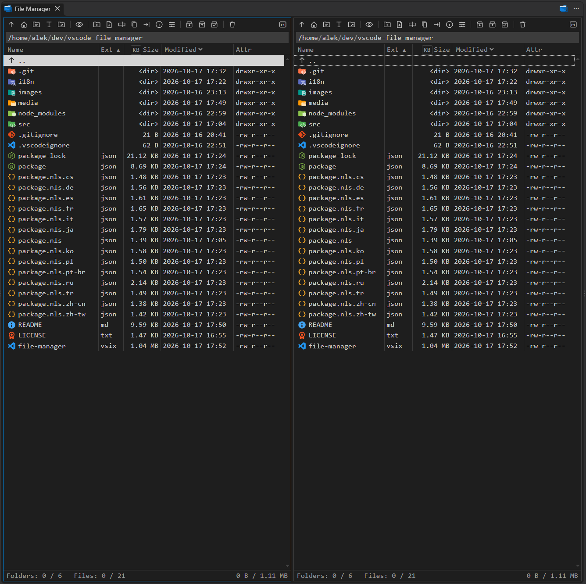

# File Manager

A two-panel file manager in an editor tab, in the spirit of Total Commander and Midnight Commander: copy, move, rename, delete, attributes, properties and archives, by toolbar, keys and drag and drop.



## Installation

```bash
code --install-extension file-manager.vsix
```

Or in VS Code: **Extensions** panel → `...` menu → **Install from VSIX…**. After installing, reload the window (**Developer: Reload Window**).

Requires VS Code 1.94 or later. In a remote window (WSL, SSH, containers) the extension runs on the remote side and shows its file system.

## Opening

- The File Manager button in the title bar of any editor tab shows the File Manager tab used last, or opens one.
- The same button on a File Manager tab opens one more next to it.
- **File Manager: Open File Manager** in the Command Palette.

A new tab opens both panels in the folder chosen by the `fileManager.startFolder` setting: the folders last open in this workspace (the default), the home folder, the project folder or the root. A tab restored after a window reload reopens its own folders.

## Panels

- Columns: name, extension, size, date, attributes. The date column shows modification, creation or access time, chosen in its header.
- Click a column header to sort by it, again to reverse. Folders always come first.
- Sizes are shown in KB, MB, GB with two decimals; the `KB` button in the header switches to bytes. A folder shows `<dir>` until its size is counted.
- The extension and size columns fit their longest value in the folder. Drag a divider in the header to set a width by hand; double-click it to go back to the automatic width.
- Ctrl+mouse wheel scales the tables, as in the editor; the scale is kept in the `fileManager.tableScale` setting.
- Drag the line between the panels to resize them; double-click it for equal halves.
- The path above the list is clickable: a click on a part of it opens that folder, a click after it lets you type a path (relative, `~` and paths to files work).
- The list follows changes on disk while it is open. Folders on file systems that report no changes (WSL `/mnt/c`, network shares, FUSE) are polled.
- The status line under each panel counts folders and files, selected and all, and their size.
- File icons come from the active file icon theme.

## Toolbar

- Parent folder, home folder, project folder (a list when the workspace has several), root (the drive list on Windows).
- Open this folder in the system file manager.
- Show or hide hidden files.
- New folder, new file, rename, copy, move, properties, attributes.
- Pack, unpack, test archives.
- Delete; with Shift, permanently.
- Help (`F1`), always at the right edge.

Buttons that do not fit a narrow panel go, from the end, into the `⋯` menu next to Help.

An operation works on the selected entries, or on the entry under the cursor when nothing is selected. Copy and move go to the folder of the other panel.

## Keys

The function keys work while a File Manager tab is active; elsewhere VS Code keeps its own. On macOS ⌘ takes the place of Ctrl everywhere in the File Manager, including Ctrl+click and Ctrl at a drop, and the tooltips and the help write the keys with the Mac symbols: ⌘U, ⇧F8, ⌥F5.

- `Tab` — other panel
- `↑` `↓` `PgUp` `PgDn` `Home` `End` — move the cursor
- `Enter`, double-click — open a folder or an archive; a file opens in an editor tab
- `Backspace` — parent folder
- `Insert` — select or unselect, cursor down
- `Space` — select or unselect; on a folder, count its size
- `Alt+Shift+Enter` — count the size of every folder
- `Esc` — stop counting
- `Ctrl+U` — swap the panels
- `F1` — help: keys, mouse, toolbar
- `F2` — rename
- `F3` — properties
- `F4` — open the file in an editor tab, an archive included
- `Shift+F4` — new file
- `F5` — copy
- `F6` — move
- `F7` — new folder
- `F8`, `Delete` — delete
- `Shift+F8`, `Shift+Delete` — delete permanently
- `F9` — attributes
- `Alt+F5` — pack
- `Alt+F9` — unpack
- `F10` — close the tab

## Mouse

- Click on an icon, or Ctrl+click — select or unselect one entry.
- Shift+click — select a range; Ctrl+Shift+click adds it to the selection.
- Click on a row — cursor there, selection cleared.

## Drag and drop

Drag entries to the other panel to move them; hold Ctrl at the drop to copy. Dropped on a folder row, they go into that folder; anywhere else, into the folder the panel shows. A dialog with the destination comes first. Esc cancels the drag. Nothing is dropped inside the panel the drag started from.

## File operations

- **Copy and move** show the destination in a dialog; for a single entry it includes the name, so the copy can get a new one. Every copied file is read back and compared with the checksum taken while copying (CRC-32, or SHA-1 where Node has no CRC-32). A move between volumes deletes a source file only after its copy has passed that check; inside one volume a move is a rename. Dates and permissions of the source are kept where the file system allows.
- **Name conflicts** ask, for one file or for all: overwrite, keep both (`name (1).ext`), skip, cancel. Overwriting replaces the file in place.
- **Errors** on single files ask: retry, skip, skip all, abort.
- **Progress** shows in a corner of the tab, with the current file for big files, totals, speed and Cancel; the panels stay usable.
- **Delete** always asks. Without a trash, or with Shift, a second confirmation follows, and its button unlocks after five seconds. The trash is used where VS Code reaches one: in a local window, not in WSL or other remote windows.
- **Rename** opens a dialog; "Hide file extension" (on by default, kept in the `fileManager.hideExtensionOnRename` setting) leaves the extension as it is.
- **Names** are checked before anything is written. Under Windows and WSL the Windows rules apply: no `< > : " / \ | ? *`, no reserved names such as `CON`, no trailing dot or space.
- **Attributes**: permission bits with an octal field on Linux and macOS, Read-only, Hidden, System and Archive on Windows. Only the bits changed in the dialog are applied, also to a selection with different attributes, and optionally to everything inside folders. Links are not changed.
- **Properties**: type, size, dates, attributes, owner, link target. Folder content is counted while the dialog is open.

## Archives

- Zip, tar and tar.gz (`.tgz`) open like folders, read only. Names in old zip files written in the Russian DOS code page (CP866) are shown correctly.
- **Unpack** extracts whole archives into a folder, optionally into a subfolder named after each archive. Zip files are checked against their stored CRC-32. Entries that would land outside the folder — `..`, absolute paths, links pointing out — are refused.
- **Pack** creates a zip, tar or tar.gz and checks it afterwards; an archive that fails, is cancelled or does not pass the check is removed. Zip has no links, so links are skipped there.
- **Test** reads archives without writing anything and lists every damaged entry.

Not supported yet:

- 7z and the formats 7-Zip reads (rar, arj, cab, lzh, iso, tar.bz2, tar.xz and others) — one step that covers most of the archives in use; how it is done is left for a later version;
- working with archive contents in place: opening, copying or extracting single entries without unpacking the whole archive;
- encrypted, password-protected archives;
- folders protected by file system encryption (EFS on Windows, fscrypt, eCryptfs and similar).

## Settings

All settings are in **Settings → Extensions → File Manager** and apply to both panels of every tab. The language settings are user settings only, so a workspace cannot change them.

- `fileManager.language` — language of the interface; `auto` follows VS Code.
- `fileManager.customTranslations` — your own dictionary, see [Languages](#languages).
- `fileManager.startFolder` — `last`, `home`, `project` or `root`: where a new tab opens.
- `fileManager.tableScale` — pixels added to the editor font size in the tables; Ctrl+mouse wheel changes it.
- `fileManager.hideExtensionOnRename` — the rename dialog shows the name without its extension.
- `fileManager.unpackIntoSubfolder` — unpack into a subfolder named after the archive.
- `fileManager.packFormat` — `zip`, `tgz` or `tar`, offered when packing.

## Languages

English, Čeština, Deutsch, Español, Français, Italiano, 日本語, 한국어, Polski, Português (Brasil), Русский, Türkçe, 简体中文, 繁體中文 — the languages VS Code ships language packs for. With `auto` the language of VS Code is used; without a dictionary for it, English. Command titles and setting descriptions follow the language of VS Code.

*The translations were made with an AI tool and may be inaccurate. A native speaker is always welcome to send a pull request with corrections to `i18n/<language>.json` and `package.nls.<language>.json`.*

For a language not in the list, put a dictionary into `fileManager.customTranslations`: the keys and texts as in [`i18n/en.json`](i18n/en.json), `{name}` placeholders kept. A non-empty dictionary is used instead of `fileManager.language`; keys it lacks are shown in English.

## Platforms

- **Windows**: the drive list above the drive roots; attributes are read and changed through one PowerShell process started when needed.
- **WSL**: names follow the Windows rules, since the same folders are used from Windows. The system file manager button opens Windows Explorer.
- **Linux, macOS**: POSIX permissions and owners.

## Building from source

```bash
npm install
npm run check
npm run build
```

`npm run check` runs the TypeScript checker over the JavaScript sources; `npm run build` writes `file-manager.vsix`.

## License

BSD 3-Clause License.
